# PayFlow Architecture Overview

```mermaid
flowchart TD
    subgraph Clients["Clients & External Actors"]
        MerchantApp["Merchant Application / E-commerce"]
        DashboardUser["Merchant Admin / Ops User"]
    end

    subgraph API_Gateway["Edge & Ingress (Spring Security Filter Chain)"]
        AuthFilter["JWT & API Key Authentication"]
        IdempotencyFilter["Idempotency Filter (PG Backed)"]
        RateLimiter["Rate Limiting & SSRF Check"]
    end

    subgraph Core_Monolith["PayFlow Modular Monolith (Spring Boot 3.x)"]
        direction TB
        subgraph Mod_Identity["Identity & Merchant Module"]
            UserMgr["User & Auth Service"]
            MerchantMgr["Merchant & API Key Manager"]
        end

        subgraph Mod_Payment["Payment & Idempotency Module"]
            PaymentService["Payment Processing Engine"]
            PaymentSM["Payment State Machine"]
            IdempotencyService["Idempotency Coordinator"]
        end

        subgraph Mod_Risk["Risk Engine"]
            RuleEvaluator["Explainable Rules Engine (Velocity, Amount, Declines)"]
        end

        subgraph Mod_Provider["Provider Orchestration"]
            ProviderRouter["Provider Routing Policy"]
            StripeSim["Stripe Simulator (Success, Decline, Timeout)"]
            AdyenSim["Adyen Simulator (Success, Decline, Timeout)"]
        end

        subgraph Mod_Ledger["Double-Entry Ledger Module"]
            JournalPoster["Atomic Journal Poster"]
            AccountService["Account & Balance Derived Engine"]
            LedgerInvariant["Double-Entry Invariant Guard (Debits == Credits)"]
        end

        subgraph Mod_Refund["Refund Module"]
            RefundService["Refund Engine & State Machine"]
            ReversalPoster["Ledger Reversal Coordinator"]
        end

        subgraph Mod_Outbox["Transactional Outbox & Eventing"]
            OutboxWriter["Atomic Outbox Event Writer"]
            OutboxPublisher["Scheduled Kafka Publisher"]
            InboxDeduper["Consumer Inbox Deduplicator"]
        end

        subgraph Mod_Recon["Reconciliation & Audit"]
            ReconEngine["Reconciliation Discrepancy Analyzer"]
            AuditLogger["Append-Oriented Security & Financial Audit"]
        end

        subgraph Mod_Webhook["Webhook Engine"]
            WebhookDispatcher["Signed Webhook Dispatcher (SSRF Guarded)"]
            WebhookRetry["Backoff & Redelivery Scheduler"]
        end
    end

    subgraph Data_Stores["Infrastructure & Data Layer"]
        PostgreSQL[("PostgreSQL\n(Source of Truth:\nLedger, Payments, Outbox)")]
        RedisCache[("Redis\n(Rate Limit & Cache)")]
        Kafka[("Apache Kafka\n(Domain Event Topics)")]
    end

    subgraph Observability["Observability & Monitoring"]
        Prometheus["Prometheus Metrics"]
        Grafana["Grafana Dashboards"]
        Otel["OpenTelemetry Tracing & Structured Logs"]
    end

    MerchantApp -->|HTTPS / REST API| AuthFilter
    DashboardUser -->|HTTPS / React SPA| AuthFilter
    AuthFilter --> IdempotencyFilter
    IdempotencyFilter --> RateLimiter

    RateLimiter --> PaymentService
    RateLimiter --> UserMgr
    RateLimiter --> RefundService

    PaymentService --> RuleEvaluator
    RuleEvaluator -->|Approved| ProviderRouter
    ProviderRouter --> StripeSim
    ProviderRouter --> AdyenSim

    PaymentService -->|Atomic Transaction| PostgreSQL
    PaymentService --> JournalPoster
    JournalPoster --> LedgerInvariant
    LedgerInvariant --> PostgreSQL
    PaymentService --> OutboxWriter
    OutboxWriter --> PostgreSQL

    OutboxPublisher -->|Poll Pending| PostgreSQL
    OutboxPublisher -->|Publish| Kafka
    Kafka --> InboxDeduper
    InboxDeduper --> WebhookDispatcher
    WebhookDispatcher -->|Signed HMAC POST| MerchantApp

    ReconEngine --> PostgreSQL
    AuditLogger --> PostgreSQL
    Core_Monolith --> Prometheus
    Prometheus --> Grafana
```

## Financial Invariants
1. **Mathematical Balance**: For every ledger journal transaction, the sum of debits must strictly equal the sum of credits per currency:
   $$\sum_{i} \text{Debit}_i = \sum_{j} \text{Credit}_j$$
2. **Atomicity**: Payment state transitions (`SUCCEEDED`, `FAILED`, `UNKNOWN`) and their corresponding ledger entries and outbox events are committed in a single atomic database transaction.
3. **Immutability**: Posted ledger entries are append-only and cannot be updated or deleted. Reversals create new matching inverse entries.
4. **Refund Limit**: The sum of all successful refunds for any payment cannot exceed the captured payment amount:
   $$\sum \text{RefundAmount} \le \text{CapturedAmount}$$
5. **Idempotency**: Identical `(merchant_id, idempotency_key)` submissions with identical payloads return the stored result. Differing payloads return HTTP 409 Conflict. Concurrent submissions are serialized and never create multiple payments.

